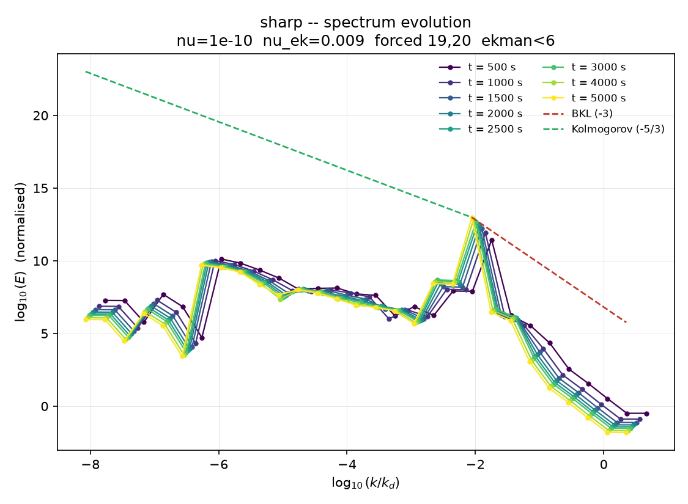
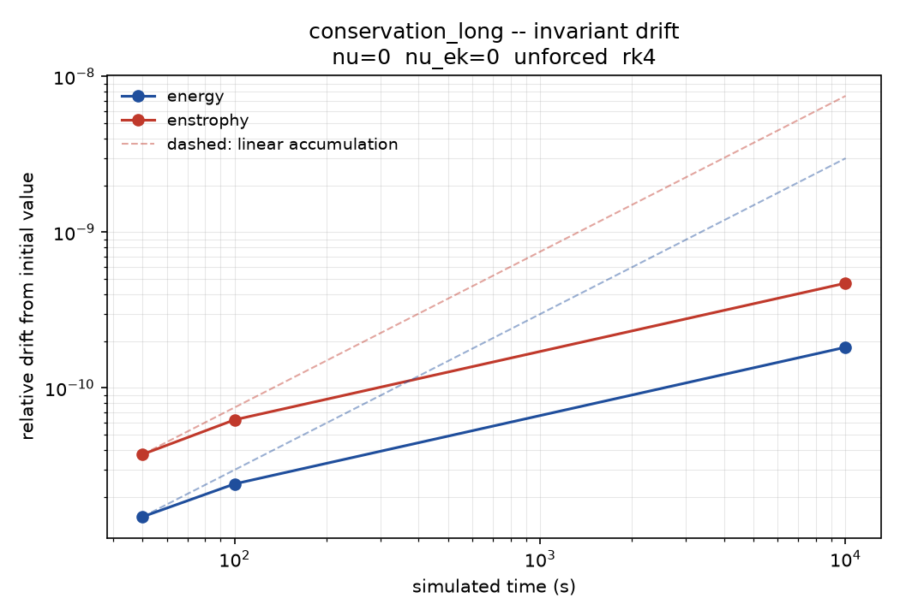

# GOY shell model for 2D turbulence

A C++17 rewrite of the simulation from *Study of fluid turbulence using the GOY
shell model and semi-analytical modelling of nonlinear interactions*
(IIT Madras, 2016), together with the original C for reference. 
The thesis is not publicly hosted; available on request.

The model reduces the spectral Navier-Stokes equations to 29 geometrically
spaced shells in wavenumber space, retaining only local nonlinear couplings.
The coupling coefficients are constructed so that the nonlinear terms conserve
both energy and enstrophy exactly, which is what makes the two inviscid
invariants available as a correctness check.

The C++ port was done with AI assistance (Claude). The original implementation
and the physics are mine, as is the analysis of the defects the port exposed.

## Build

Requires a C++17 compiler and CMake 3.16+.

```bash
cmake -S . -B build -DCMAKE_BUILD_TYPE=Release
cmake --build build -j
ctest --test-dir build --output-on-failure
```

**macOS note.** On macOS 26 (Tahoe), the Command Line Tools ship an SDK newer
than their linker understands, and any C++ link fails with
`tapi error: malformed file`. Build with Homebrew's LLVM instead:

```bash
brew install llvm cmake
cmake -S . -B build -DCMAKE_BUILD_TYPE=Release \
  -DCMAKE_CXX_COMPILER=$(brew --prefix llvm)/bin/clang++
```

The build is warning-free under `-Wall -Wextra -Wpedantic -Wshadow
-Wconversion -Wdouble-promotion`. Do not enable `-ffast-math`: the compensated
summation in `Model::energy` and `MeanSquare::accumulate` relies on
IEEE-conformant arithmetic, and the optimiser will algebraically cancel it away.

## Run

```bash
# thesis section 3.3.2 configuration (the one printed in Appendix A)
./build/goy --preset sharp --time 12000 --name sharp

# thesis section 3.3.1, reproducing Ohkitani & Yamada
./build/goy --preset oy --time 12000 --name oy

# inviscid, unforced: both invariants should hold
./build/goy --preset conservation --time 10000 --name conservation_long

# viscosity sweep, one thread per configuration
./build/goy --preset sharp --time 5000 --sweep-nu 1e-10,1e-8,1e-7

./build/goy --help
```

Output goes to `runs/<name>/` as `spectra.csv`, `scalars.csv` and
`parameters.txt`. The manifest records every value that defined the run,
integrator included, so a figure always carries its provenance. Raw values are
written, not logarithms — the normalisation is applied in the analysis layer,
so a mistake in it can be corrected without re-running anything.

## Figures

```bash
python3 -m venv .venv && source .venv/bin/activate
pip install matplotlib pandas numpy
python3 analysis/plot.py runs/sharp
```


## What changed from the 2016 code

The original is preserved at `original/goy_original.c`. Five defects were found
while porting.

**Initial conditions were not random.** `srand(time(NULL))` was called inside
the per-shell random function, so all 29 calls landed in the same wall-clock
second, reseeded identically, and returned the same magnitude. The initial state
was a constant vector with alternating signs, not a random draw. A single
generator is now seeded once from `Parameters::seed`, which makes runs both
genuinely random across shells and exactly reproducible. This also means the
thesis's 20-member ensemble was far less diverse than intended: it varied one
scalar, not a point in a 29-dimensional space.

**The spectrum normalisation dropped a factor.** `pow(eta, -1/6)` uses integer
division: `-1/6` is `0`, so the factor evaluated to 1 and vanished. Cascade
slopes were unaffected, but the vertical placement of each spectrum was off by a
time-varying amount, so curves at different times were never comparable. Note
that `-Wall -Wextra` does not catch this; `-Wconversion` does.

**An accidental variable-length array.** `double E[N], Enorm[i], E1[N];` sized
`Enorm` by a loop counter rather than by `N`. It happened to be correct only
because the preceding loop exited with `i == N`; any reordering would have
corrupted memory silently.

**Precision and speed in the hot loop.** `pow(k[i], 2)` was called four times
per shell per step — about 5e10 `pow` calls over the longest run — and the
mean-square accumulator summed naively into a double over 4.8e8 steps, losing
low-order bits systematically. Squares and reciprocals are now precomputed and
accumulation is Kahan-compensated. This matters here because the shells span
many decades: in the inviscid run below, energy is 5.4e-06 while enstrophy is
2.4e+04, a nine-order-of-magnitude spread within the same sum.

**A signed/unsigned guard that would have failed silently.** The port initially
indexed vectors with `int`, which `-Wconversion` flags. Converting the loop
counters to `std::size_t` exposed a latent bug: the neighbour guards were
written `(i - 1 >= 0)`, and on an unsigned counter `i - 1` wraps to a very large
value when `i == 0` rather than going negative, so the guard is always true and
the read runs off the start of the array. They are now `(i >= 1)` and
`(i >= 2)`.

Measured on the same step count (5e7 steps, 29 shells): on an Apple M-series
laptop the C version runs at 2.5M steps/s and the C++ version at 5.4M steps/s —
a 2.1x speedup, from removing `pow` and the per-shell branches from the
inner loop. No SIMD intrinsics and no threading within a run.

## The open question from the thesis

The thesis reports that the energy spectrum develops a peak that grows without
bound, that Ekman friction has no effect on it, and that kinematic viscosity
does. It leaves open whether this is physical or numerical drift accumulating in
fixed-step RK4 over hundreds of millions of steps.

Running inviscid and unforced, where energy and enstrophy are exact invariants
of the coupling coefficients, settles the numerical half:

```bash
./build/goy --preset conservation --time 10000 --name conservation_long
```

| simulated time | steps | energy            | enstrophy     |
|----------------|-------|-------------------|---------------|
| 10             | 1e5   | 5.36584260177e-06 | 24002.0308132 |
| 50             | 5e5   | 5.36584260169e-06 | 24002.0308123 |
| 100            | 1e6   | 5.36584260164e-06 | 24002.0308117 |
| 10000          | 1e8   | 5.36584260079e-06 | 24002.0308019 |



Relative energy drift over 1e8 steps is 1.8e-10; enstrophy, 4.7e-10. More
importantly, the drift does not accumulate linearly: the final interval carries
200 times the steps of the first but only about 10 times the drift, consistent
with round-off that partly cancels rather than systematic leakage.

So at the step count where the blow-up actually appears, the integrator is
losing roughly two parts in 1e10 of the energy, while the reported phenomenon
involves growth by orders of magnitude. Numerical drift in the time stepper does
not explain it. The `--integrator heun` option gives a second, independent check
at a different order of accuracy.

`tests/test_goy.cpp` keeps a fast 1e6-step version of this as a regression
guard; the 1e8-step run above is the one to quote.

## Tests

`ctest` runs a self-contained suite with no external framework, so a fresh clone
needs nothing downloaded. It checks that the nonlinear terms conserve both
invariants to round-off, that the invariants survive long integration, that runs
are bit-for-bit reproducible from the seed, that initial conditions genuinely
vary across shells (the 2016 bug would fail this), that RK4 shows fourth-order
convergence under step-size halving, and that RK4 conserves energy better than
the second-order Heun scheme.

## Layout

```
include/goy/     parameters, model, integrators, recorder, simulation driver
src/             implementations and the CLI
tests/           self-contained test suite, no external framework
analysis/        plotting
original/        the 2016 C code, preserved
```

`Model` and the integrators are separate: `run<Stepper>` is templated on the
stepping scheme, so RK4 and Heun are interchangeable at zero runtime cost and a
third scheme is an additional class rather than an edit to existing code.

## Notes

The thesis describes the integrator as "Runge-Kutta 4-5". It is fixed-step
classical RK4 with no embedded error estimate and no step-size control.

The `iter[]` declaration in the printed appendix appears commented out, yet
`main` uses it. It has been restored with the printed values, which are
consistent with the run times reported in the figures.

The appendix listing is the section 3.3.2 configuration — forcing at shells 19
and 20, Ekman friction on the first 5 — not the Table 3.1 parameters that
produce Figs. 3.1–3.8. The `oy` preset covers the latter.
